# 🚀 Awesome Autonomous AI Developer Agents

### 🧠 The Definitive Curated Landscape of Autonomous Software Engineering Agents, Sandboxed Coding Runtimes & MCP Tool-Use Frameworks

  
  
  
  
  
  

**A battle-tested directory of cutting-edge AI software engineering platforms, CLI coding executors, multi-agent frameworks, benchmark leaderboards, and safe execution sandboxes.**

---

## 📑 Table of Contents

- [🌟 Overview](#-overview)
- [📈 Sector Overview & Market Dynamics](#-sector-overview--market-dynamics)
- [🏢 SaaS & Hosted Platforms](#-saashosted-platforms)
- [💻 Open-Source GitHub Projects](#-open-source-github-projects)
- [🔬 Benchmarks, Sandboxes & Infra Tools](#-benchmarks-sandboxes--infra-tools)
- [🤝 How to Contribute](#-how-to-contribute)
- [💖 Support & Sponsor](#-support--sponsor)
- [📊 Star History](#-star-history)
- [⚠️ Disclaimer](#️-disclaimer)

---

## 🌟 Overview

Welcome to the definitive, SEO-optimized directory tracking **Autonomous AI Developer Agents** and **AI Software Engineering (SWE) Systems**.

Autonomous developer agents represent a transformative shift in computer programming: moving from passive inline autocomplete to proactive, self-directed agents. Powered by long-context reasoning models, automated test-driven feedback loops, headless browsers, isolated Docker/microVM sandboxes, and the **Model Context Protocol (MCP)**, these agents autonomously:

- 🔍 **Investigate codebases** across millions of tokens and AST dependencies.
- 📋 **Formulate multi-step implementation plans** from natural-language GitHub issues and PRDs.
- 🛠️ **Edit, refactor, and write multi-file patches** across complex monorepos.
- 🧪 **Execute test suites, linting routines, and terminal commands** to self-heal build failures.
- 🚀 **Open production-ready pull requests** with comprehensive context and validation reports.

---

## 📈 Sector Overview & Market Dynamics

The global AI in software development and autonomous agent market is experiencing hyper-growth, expanding from an estimated **$5.1 billion to $9.2 billion** toward a projected **$50 billion to $150+ billion by 2032–2034** at an accelerating **32%–43.5% CAGR**. 

Structurally, the ecosystem exhibits a dual dynamic: it is **heavily concentrated at the foundational infrastructure layer** (dominated by Microsoft, OpenAI, Anthropic, and hyperscalers controlling frontier reasoning models), yet **highly fragmented across the autonomous agent and workflow execution tier**, where venture-backed disruptors and open-source ecosystems compete vigorously across IDEs, terminal CLIs, cloud sandboxes, and SWE-bench rankings without any single player establishing an uncontested winner-take-all monopoly.

---

## 🏢 SaaS/Hosted Platforms

The following table evaluates the leading commercial and enterprise autonomous developer agent platforms. The entries are sorted by **Company Scale (Valuation / Market Capitalization) in descending order**.

| Rank | Platform / Product | Company Scale (Valuation / Revenue) | Starting Tier Pricing | Free Tier / Trial Limits | Primary Agent Focus & Capabilities |
| :---: | :--- | :--- | :--- | :--- | :--- |
| 1 | [GitHub Copilot Workspace & Agent](https://github.com/features/copilot) | **$3.6T+ Market Cap** (Microsoft / GitHub; $330B+ revenue) | **$10 / month** (Copilot Pro) | **Copilot Free**: 2,000 code completions/month, 50 chat messages/month, standard model routing | Repository-native coding agent integrated into GitHub Issues & PRs for specification planning, automated file diffs, and CI loop validation. |
| 2 | [Claude Code (Anthropic)](https://www.anthropic.com) | **$60B+ Valuation** ($4B+ ARR run-rate) | **$20 / month** (Claude Pro) or metered API token billing | **No permanent free tier** for Claude Code; free web app offers standard chat only with 5-hour rolling prompt caps | Agentic command-line software engineering harness navigating local repositories, executing terminal commands, editing files, and self-verifying test suites. |
| 3 | [Cursor Background Agents](https://cursor.com) | **$60B Acquisition Value** (SpaceXAI / Anysphere; $2B+ ARR) | **$20 / month** (Pro Tier) | **Hobby Tier (Free)**: 2-week Pro trial with 50 fast requests, then 2,000 completions/month and 50 slow agent requests/month | AI-native fork of VS Code with asynchronous background cloud agents that run terminal tasks, inspect web UI snapshots, and produce multi-file PRs. |
| 4 | [Devin (Cognition AI)](https://cognition.ai) | **$48B Valuation** ($1B+ ARR run-rate) | **$20 / month** (Devin Pro) | **Devin Desktop Free**: Unlimited Tab auto-completions, unlimited inline edits, and lightweight trial quota for local basic agent evaluation | Flagship autonomous AI software engineer featuring an isolated cloud virtual machine, code editor, browser, and planning engine to resolve GitHub issues end-to-end. |
| 5 | [Replit Agent](https://replit.com) | **$9B Valuation** ($500M ARR run-rate) | **$20 / month** (Replit Core with $25 monthly agent credits) | **Starter Free Tier**: Basic daily agent prototyping allowance, 1 public published project, and community cloud resources | Cloud IDE autonomous agent scaffolding, configuring PostgreSQL databases, debugging server errors, and deploying full-stack web applications from text prompts. |
| 6 | [Factory AI (Droids)](https://factory.ai) | **$5B Valuation** ($400M+ funding raised) | **$20 / month** (Pro Developer Tier) | **Free Trial Only**: 1-hour active autonomous execution sandbox trial for evaluating initial Missions and Droid workflows | Enterprise autonomous developer platform deploying specialized "Droids" for feature generation, dependency migrations, code reviews, and bug triage. |
| 7 | [Magic.dev](https://magic.dev) | **$1.5B Valuation** ($465M+ funding raised) | **Developer Preview / Enterprise Quoted** (B2B tier agreements) | **Free Developer Preview**: Limited evaluation access during research model rollout with quota-capped LTM reasoning requests | Frontier AI lab deploying ultra-long-context (100M+ token) neural architectures for repository-wide automated refactoring and code synthesis. |
| 8 | [Augment Code](https://augmentcode.com) | **$977M Valuation** (~$20M ARR; $252M funding) | **$20 / month** (Individual Developer Tier) | **Free Trial Only**: 14-day evaluation trial with pooled team credits; no permanent free tier | Enterprise autonomous agent engineered for massive multi-million-line repositories using real-time semantic retrieval and cross-codebase dependency graphs. |
| 9 | [Cosine (Genie / Lumen)](https://cosine.sh) | **$50M+ Valuation** (Seed stage; ~$10M estimated run-rate) | **$19 / month** (Starter Tier) | **No permanent free tier**; credit-based usage sandbox evaluation upon account signup | Autonomous AI software engineer trained on developer behavioral traces to investigate multi-file codebases, write tests, and submit SWE-bench validated PRs. |

---

## 💻 Open-Source GitHub Projects

The following curated open-source autonomous agents, coding executors, and SWE frameworks are sorted by **GitHub Star Count in descending order**. Every badge links directly to that repository's stargazers page.

| Repository | GitHub Stars Badge | Primary Language | Description & Key Features |
| :--- | :---: | :---: | :--- |
| **[anomalyco/opencode](https://github.com/anomalyco/opencode)** |  | Go / TypeScript | High-speed open-source terminal-first coding agent built for multi-provider LLM orchestration, LSP-powered symbol navigation, and autonomous sessions. |
| **[Significant-Gravitas/AutoGPT](https://github.com/Significant-Gravitas/AutoGPT)** |  | Python | Foundational autonomous agent framework providing long-term memory, modular agent chains, web browsing, and multi-step execution. |
| **[browser-use/browser-use](https://github.com/browser-use/browser-use)** |  | Python | Open-source browser automation agent enabling AI coding systems to visually interact with, test, and audit web applications and dashboards. |
| **[OpenHands/OpenHands](https://github.com/OpenHands/OpenHands)** |  | Python | Premier open-source platform for autonomous software development agents, offering Docker-isolated bash terminals, browsers, and code workspaces. |
| **[modelcontextprotocol/servers](https://github.com/modelcontextprotocol/servers)** |  | TypeScript / Python | Anthropic's reference Model Context Protocol (MCP) servers (Git, Postgres, Docker, Playwright, Filesystem) powering standardized agent tooling. |
| **[cline/cline](https://github.com/cline/cline)** |  | TypeScript | Autonomous VS Code coding assistant capable of editing files, executing terminal commands, launching headless browsers, and connecting MCP tools. |
| **[FoundationAgents/MetaGPT](https://github.com/FoundationAgents/MetaGPT)** |  | Python | Multi-agent software company simulation framework assigning Product Manager, Architect, and Engineer roles to deliver end-to-end software specifications. |
| **[aaif-goose/goose](https://github.com/aaif-goose/goose)** |  | Rust | High-performance, local-first on-machine AI developer agent under the Agentic AI Foundation with native Model Context Protocol (MCP) server support. |
| **[AntonOsika/gpt-engineer](https://github.com/AntonOsika/gpt-engineer)** |  | Python | Popular open-source CLI platform that generates entire codebases from natural language specifications and systematically prompts for architectural clarifications. |
| **[Aider-AI/aider](https://github.com/Aider-AI/aider)** |  | Python | Leading terminal AI pair-programming agent with whole-repository AST repo-mapping, automatic git commits, and closed-loop test/lint self-healing. |
| **[continuedev/continue](https://github.com/continuedev/continue)** |  | TypeScript | Modular open-source IDE coding assistant and headless agent framework compatible with local Ollama models and frontier commercial APIs. |
| **[OpenBMB/ChatDev](https://github.com/OpenBMB/ChatDev)** |  | Python | Collaborative multi-agent software development simulator where virtual agents chat to design, code, review, and test complete applications. |
| **[RooCodeInc/Roo-Code](https://github.com/RooCodeInc/Roo-Code)** |  | TypeScript | Advanced autonomous multi-mode VS Code extension featuring specialized Architect, Code, Debug, and Custom modes with strict security approval gates. |
| **[SWE-agent/SWE-agent](https://github.com/SWE-agent/SWE-agent)** |  | Python | NeurIPS-published autonomous coding agent by Princeton NLP utilizing an Agent-Computer Interface (ACI) designed to resolve GitHub issues automatically. |
| **[plandex-ai/plandex](https://github.com/plandex-ai/plandex)** |  | Go | Terminal-based AI coding engine engineered for large, complex engineering projects featuring branchable sandboxes and cumulative multi-file diff reviews. |
| **[e2b-dev/E2B](https://github.com/e2b-dev/E2B)** |  | Python / TypeScript | Open-source secure cloud microVM execution sandbox designed for running untrusted LLM-generated code, shell sessions, and testing suites. |
| **[SWE-bench/SWE-bench](https://github.com/SWE-bench/SWE-bench)** |  | Python | The gold-standard evaluation benchmark for autonomous developer agents, testing patch generation against real-world GitHub issues and test suites. |
| **[evalplus/evalplus](https://github.com/evalplus/evalplus)** |  | Python | Rigorous evaluation framework for LLM code generation with 80x more test cases than HumanEval to detect hallucinated patches. |

---

## 🔬 Benchmarks, Sandboxes & Infra Tools

When building or deploying autonomous software engineering systems, combining the following tools yields production-grade reliability:

- 🔒 **Execution Sandboxes**: Combine **[E2B](https://github.com/e2b-dev/E2B)** or isolated Docker containers with gVisor to prevent untrusted agent-written code from accessing internal networks or root environments.
- 🔌 **Tool Standardization**: Utilize **[Model Context Protocol (MCP)](https://github.com/modelcontextprotocol/servers)** servers to connect agents seamlessly to GitHub, PostgreSQL, Docker, and shell runtimes.
- 📊 **Rigorous Evaluation**: Benchmark all agents against **[SWE-bench](https://github.com/SWE-bench/SWE-bench)** and **[EvalPlus](https://github.com/evalplus/evalplus)** before granting automated PR-merge permissions in production.

---

## 🤝 How to Contribute

Contributions are warmly welcome! Help us keep this directory accurate, up-to-date, and useful for the developer community:

1. 🍴 **Fork the repository** to your personal account.
2. 🌿 **Create a descriptive feature branch** (`git checkout -b add-new-agent`).
3. 📝 **Add your entry** following the tabular or bulleted format (include platform name, official URL, pricing/free tier details, or repository star badge).
4. 📬 **Submit a Pull Request** with a brief summary of the changes and factual links to official sources.

---

## 💖 Support & Sponsor

If you find this curated ecosystem directory helpful, consider supporting the maintenance and continuous updates of this repository:

- ⭐ **Star this repository** to improve visibility and help other developers discover autonomous tools!
- 🍴 **Fork and share** with your engineering team, platform architects, or AI researchers.
- ☕ **Buy me a coffee & become a sponsor**: Support my open-source work directly through the **[GitHub Sponsors Dashboard](https://github.com/sponsors/ishandutta2007)**.

Thank you for being part of the open-source autonomous development movement! 🙌

---

## 📊 Star History

---

## ⚠️ Disclaimer

- This repository is a **community-curated index** provided for educational and informational purposes; inclusion does not constitute a commercial endorsement.
- Autonomous developer agents execute shell commands, alter codebases, and access network endpoints. Always run AI agents inside isolated sandbox environments (Docker containers, microVMs) with strict permission guardrails.
- Thoroughly review and test all AI-generated pull requests, infrastructure configurations, and dependency modifications before deploying to production.

---

  Maintained with ❤️ by <a href="https://github.com/ishandutta2007">Ishan Dutta</a> and the open-source AI engineering community.

